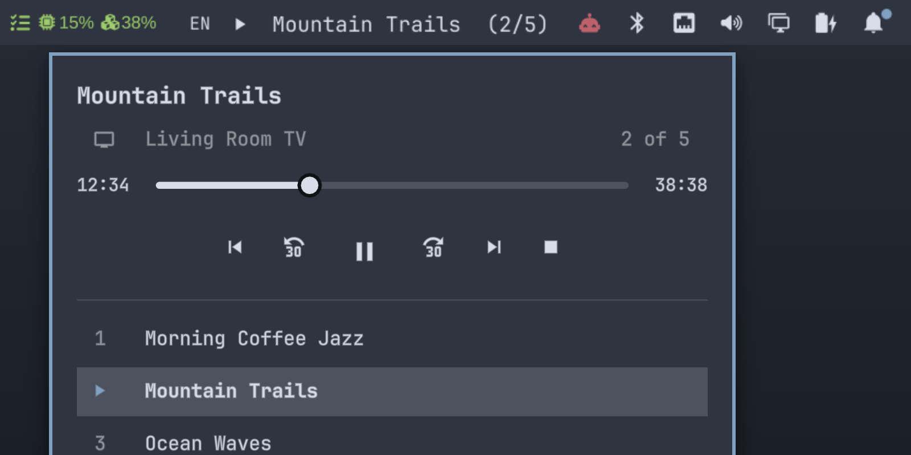

# TV Cast for Omarchy

Cast local video, audio and image files to a DLNA smart TV from Omarchy, as a
play queue you manage from the top bar. Files are served by
[go2tv](https://github.com/alexballas/go2tv). Pause, seek, stop and the queue's
auto-advance go straight to the TV over UPnP AVTransport.



## Features

- **Bar widget** (`megascan.tvcast`) is always on the bar.
  - Idle, it shows a cast icon. Click it for "Cast files…" and "Add to queue…", plus
    the TV to cast to, with a button to search again.
  - While casting, it shows `▶ Title (2/5)`. Click opens the queue panel: progress
    (click or drag the bar to seek; greyed out when the TV reports no duration), previous, −30 s, play/pause, +30 s, next and stop, the queue (hover
    an item to move or remove it, click to play it), and the file actions.
  - Middle-click pauses or resumes, right-click stops, and scrolling seeks 30 s.
- **Queue:** moves to the next file when the TV reports the current one finished.
  Stopping it yourself never skips ahead, and the queue clears itself once the last file ends.
- **Format check:** ffprobe decides whether a video needs transcoding. H.264, HEVC,
  MPEG-2 and MPEG-4 video in MP4, MKV, MOV, TS or AVI with AAC, AC3, EAC3 or MP3
  audio plays as-is. Everything else gets go2tv's ffmpeg transcode (`-tc`).
- **Subtitles:** a sidecar with the same name (`movie.srt`, `movie.en.srt`, `.vtt`,
  `.ass`, `.ssa`) is sent along automatically.
- **Images** stay on screen for 10 s (`TVCAST_IMAGE_SECONDS`), or until you stop if
  the image is last in the queue.
- **Menu entries** (optional): Trigger › Cast to TV, also `omarchy menu summon cast`.
  Cast files (multi-select), add to queue, cast to another TV, play, pause/resume,
  next, previous, ±30 s, what's playing, stop and clear queue. Entries that don't
  apply right now are hidden.

## Requirements

- Omarchy with the Quickshell bar (Quattro or later).
- [go2tv](https://github.com/alexballas/go2tv/releases): put the `go2tv` binary on
  your `PATH` or in `~/.local/bin`, or install the AUR package `go2tv`.
- `ffmpeg`/`ffprobe`, `jq`, `curl`, `libxml2` (`xmllint`) and `util-linux` (`script`).
  Omarchy ships all of these.
- A **DLNA/UPnP media renderer**, which most smart TVs are (LG webOS, Samsung,
  Sony, Philips and so on). Chromecast isn't supported yet: go2tv can cast to it,
  but this plugin's controls and queue use DLNA AVTransport.

### Firewall

Omarchy enables ufw with incoming connections denied. The TV has to reach the
media server go2tv runs on your machine, and discovery needs replies to get
back. Allow them from your LAN only:

```sh
sudo ufw allow from <your-LAN>/24 to any port 3500:4499 proto tcp   # go2tv media server
sudo ufw allow from <your-LAN>/24 to any port 3339:3438 proto udp   # go2tv discovery replies
sudo ufw allow from <your-LAN>/24 to any port 1900 proto udp        # SSDP
sudo ufw allow from <your-LAN>/24 to any port 5353 proto udp        # mDNS
```

Tighter, if your TV has a fixed address (a DHCP reservation in your router):
open the media server port to the TV alone.

```sh
sudo ufw allow from <TV-IP> to any port 3500:4499 proto tcp        # go2tv media server, TV only
```

Why: while a file is casting, go2tv serves it over plain HTTP with no password
or token, so any device that can reach that port can fetch the file. Scoping
the rule to the TV's IP keeps other machines on the network (guests, phones,
smart plugs) from reading what you cast. The discovery rules can stay
LAN-wide, since they carry no file contents.

## Install

```sh
omarchy plugin add https://github.com/megascan/omarchy-tvcast --enable
~/.config/omarchy/plugins/megascan.tvcast/install.sh --menu
```

`omarchy plugin add` installs the bar widget, and the widget works on its own.
`install.sh` links the `tvcast` CLI into `~/.local/bin`. `--menu` also adds the menu
entries to `~/.config/omarchy/extensions/omarchy-menu.jsonc`, after saving a backup
next to it. Leave out `--menu` to keep your menu untouched.

If the widget isn't on the bar yet: `omarchy bar put megascan.tvcast --section right`.

The first cast looks for TVs on the network (10–20 s). The chosen TV is remembered,
and "Cast files to another TV…" (or `tvcast cast --pick`) searches again.

## Command line

```
tvcast cast [--pick] [file...]   replace the queue and play (file picker if no files)
tvcast add [--pick] [file...]    append to the queue (starts it if it was empty)
tvcast next | prev | play-index N | remove N | move N up|down | clear | list
tvcast play | toggle | pause | resume | stop
tvcast seek +30 | seek -30 | seek 1:02:03 | seek-to <seconds>
tvcast status [--json] | devices [--json] | pick-device
```

Playback runs as the transient user service `tvcast.service`, so you can also stop
it with `systemctl --user stop tvcast`. State lives in `~/.local/state/tvcast/`
(queue) and `~/.cache/tvcast/` (now playing, last TV, go2tv's `session.log`).
`TVCAST_TRANSCODE=always|never` overrides the transcode check.

Network safety: tvcast only talks to TVs on private LAN IP addresses (10/8, 172.16/12,
192.168/16, link-local, IPv6 ULA), never follows redirects, and only sends playback
commands to the same address and port that served the TV's device description.
`TVCAST_ALLOW_LOOPBACK=1` also allows 127.0.0.1, for testing against a fake TV.

## Uninstall

```sh
~/.config/omarchy/plugins/megascan.tvcast/uninstall.sh   # stops casting; removes the CLI link, menu entries and state
omarchy plugin remove megascan.tvcast
```

## Development

From a clone, `./install.sh` copies the working tree into
`~/.config/omarchy/plugins/megascan.tvcast`, replacing what's there, because the
plugin validator doesn't allow symlinks. Run it again after each change.

## License

MIT. See [LICENSE](LICENSE).
